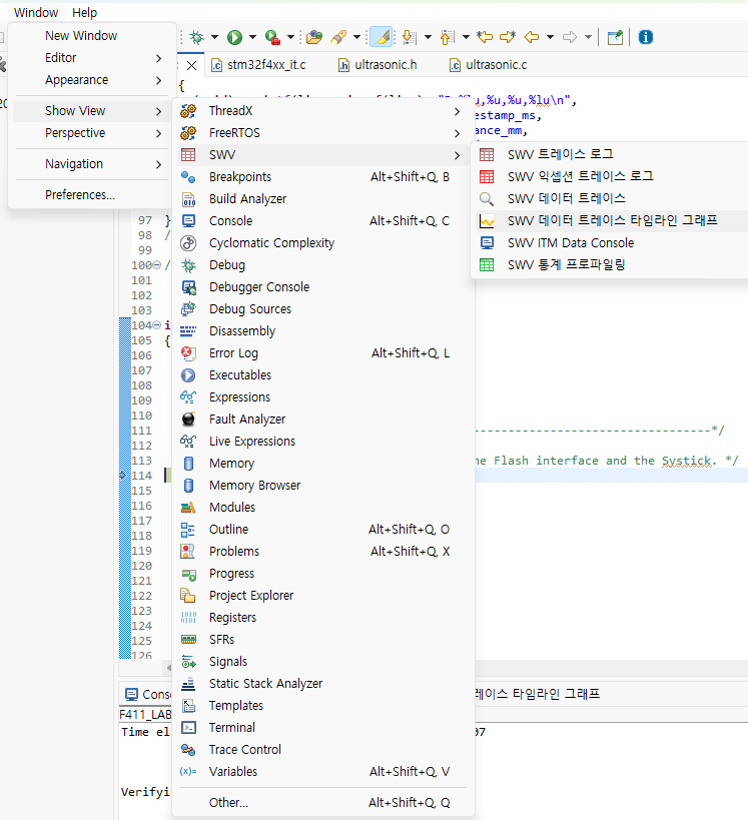
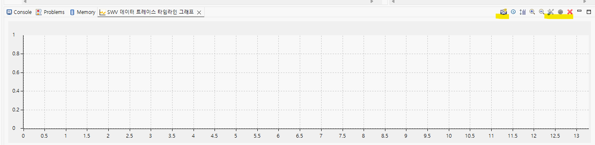
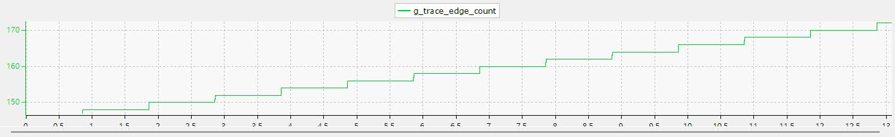
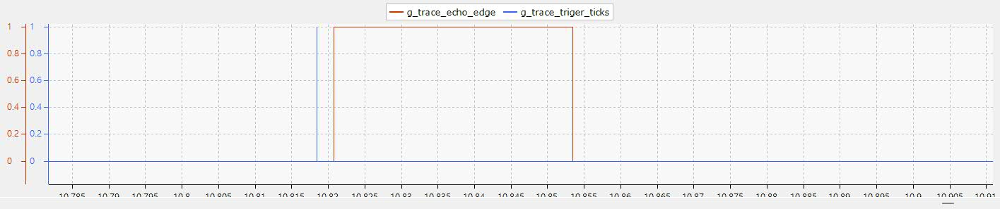
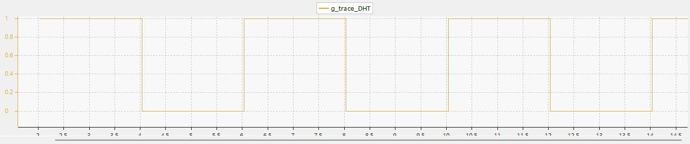
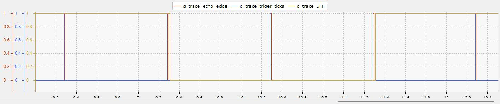
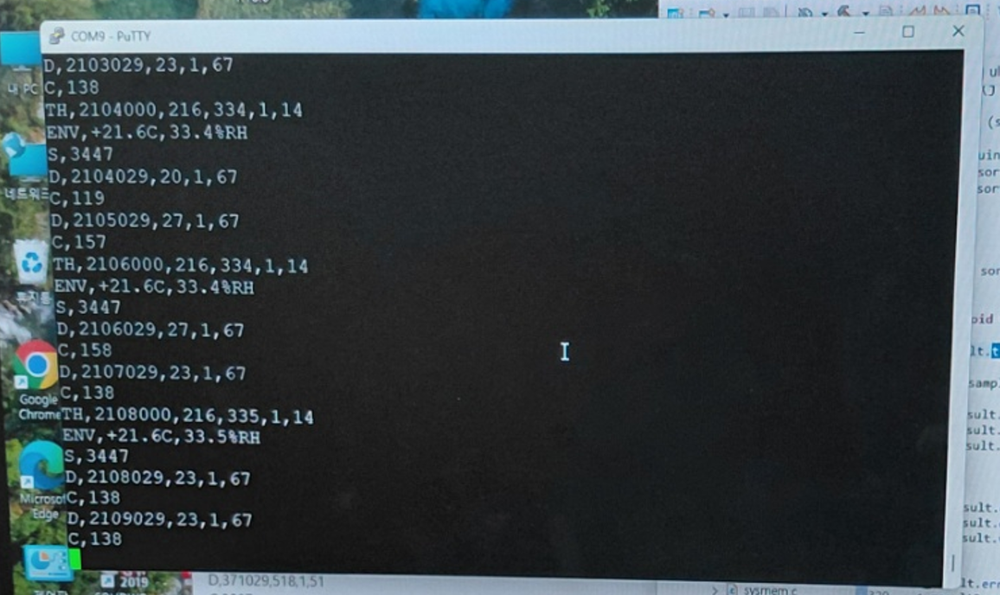

# F411_LAB
F411_LAB

핀연결
---
| 신호 | 핀 | 용도 | 비고 |
|---|---|---|---|
| ECHO | PA0 | HC-SR04 에코 | EXTI0, 기존 유지 |
| TRIG | PA1 | HC-SR04 트리거 | 기존 유지 |
| USART2_TX | PA2 | 시리얼 출력 | 기존 유지 |
| USART2_RX | PA3 | 시리얼 수신 | 기존 유지 |
| DHT DATA | PA4 | 온습도 단일선 데이터 | 내부 풀업 사용, Open-Drain으로 전환 |
| LD2 | PA5 | 보드 LED | 기존 유지 |
| 시간 기준 | TIM1 | 1 MHz 카운터 | 초음파·DHT 공용 |

보정
---
음속 보정<br>
v [0.1 m/s] = 3313 + (606 × T_x10) / 1000 + (12 × RH_x10) / 1000<br>

중간에 x10으로 하는 이유는 전달과정에서 정수형에 의해 소수점 사라질 것 대비<br>
3313은 보정 받기 전 음속<br>
코드로는 main.c의 81줄의 함수 Sensor_SoundSpeedx10의 내부 코드의 이 부분
```c
  speed_x10 = 3313 + ((606 * (int32_t)temperature_c_x10) / 1000);  //온도보정
  speed_x10 += (12 * (int32_t)humidity_rh_x10) / 1000;  //습도보정
```


디버깅에서 타임테이블 추가
---
<details>
<summary>타임테이블 추가</summary>


타임라인그래프추가법
<br>
<br>
<br>
</details>

<details>
<summary>타임테이블 사용법</summary>
  
아래 사진의 밑줄친 것 왼쪽부터 차례대로 기록 저장, 보는 변수 변경(전역변수), 기록할지여부, 기록삭제<br>
<br>

3번째 것 누른 다음의 창. 활성화 누르고 해야 수정가능, 눌러야 선택됨.
<br>

</details>


결과물들
---
<details>
  <summary><디버깅창_타임테이블></summary>

echo입력<br>
| echo전체 |
|:---:|
|  |

| ticks |
|:---:|
|  |

| edge |
|:---:|
|  |

| count |
|:---:|
|  |

| 트리거, 에코 에지 비교 |
|:---:|
|  |

| 온습도(DHT) 입력 2초마다|
|:---:|
|  |

| 트리거, 에코의 에지, 온습도(DHT) 동시 |
|:---:|
|  |


</details>


<details>
  <summary><시리얼 통신으로 본 결과></summary>

| 프리픽스 | 형식 | 설명 |
|---|---|---|
| `D` | `D,<time_ms>,<distance_mm>,<valid>,<errors>` |  보정 음속 적용 거리 (1 Hz) |
| `C` | `C,<echo_ticks>` |  마지막 에코 펄스 폭 (1 MHz 카운트 = µs) |
| `TH` | `TH,<time_ms>,<temp_x10>,<rh_x10>,<valid>,<errors>` |  온도/습도 원시값(×10), 2 초 주기 |
| `ENV` | `ENV,<+/-><T>.<t>C,<RH>.<r>%RH` |  사람이 읽기 쉬운 온습도 |
| `S` | `S,<speed_x10>` |  DHT 유효 시 적용된 음속 (유효하지 않으면 미출력), x10된 크기 |

| 초음파+온습도_근접 |
|:---:|
|  |


| 초음파+온습도 멀리서 |
|:---:|
|  |


  </details>
