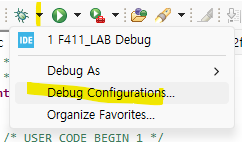
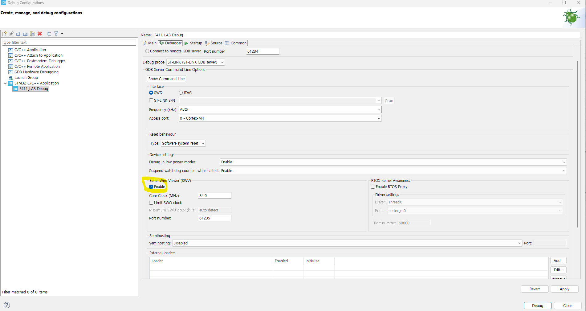
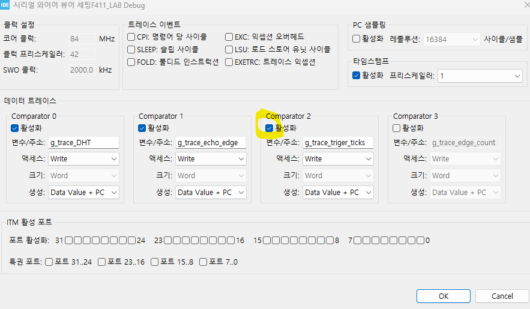
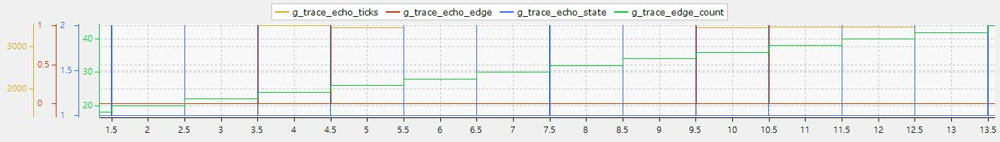
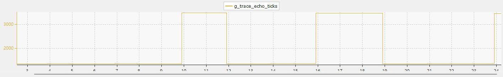
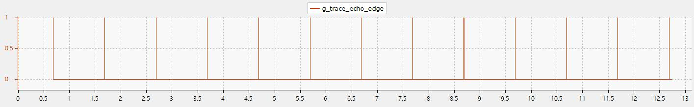
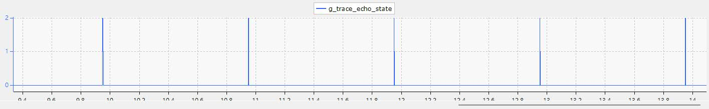
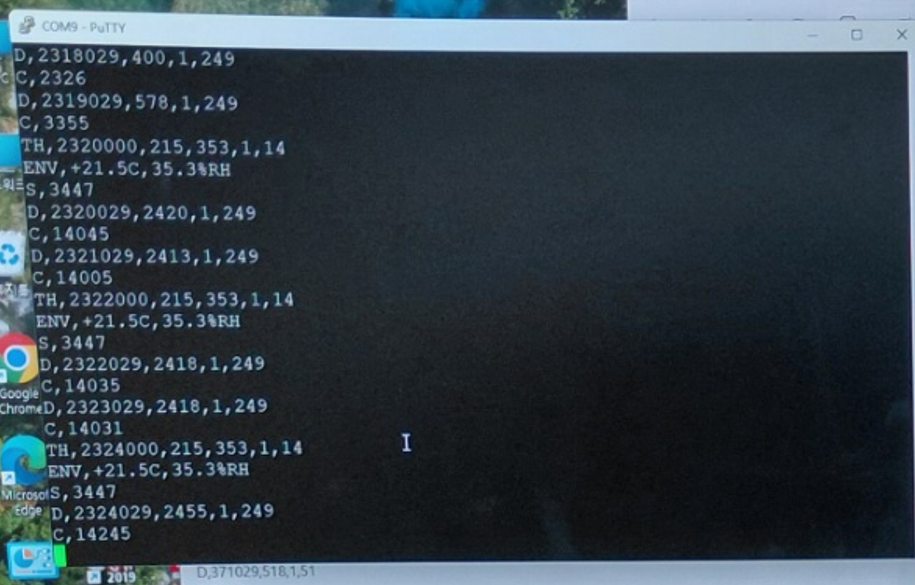

# F411_LAB
F411_LAB

디버깅에서 타임테이블 추가
---

타임테이블 추가

타임라인그래프추가법
 
 
 

타임테이블 사용법

아래 사진의 밑줄친 것 왼쪽부터 차례대로 기록 저장, 보는 변수 변경(전역변수), 기록할지여부, 기록삭제 
 
3번째 것 누른 다음의 창. 활성화 누르고 해야 수정가능, 눌러야 선택됨.
 

<결과물들>
---
echo입력 
| echo전체 |
|:---:|
|  |

| ticks |
|:---:|
|  |

| edge |
|:---:|
|  |

| count |
|:---:|
|  |

| state |
|:---:|
|  |

| 초음파+온습도_근접 |
|:---:|
|  |

| 초음파+온습도 멀리서 |
|:---:|
|  |

</결과물들>
